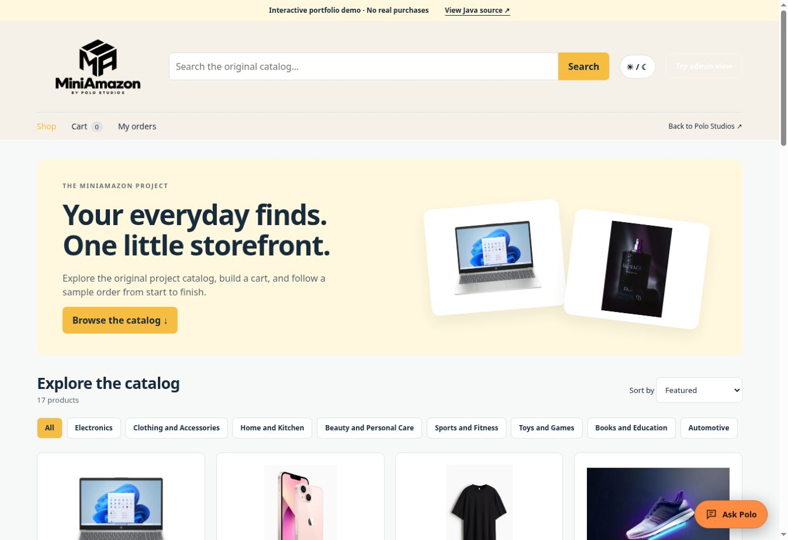

# MiniAmazon

**An e-commerce workflow demo with a separate Java/JSP/MySQL application.**

[](https://github.com/pologram1/Mini-Amazon-WebPage/actions/workflows/validate.yml)



## At a glance

The polished browser demo includes stock-aware product quantity selection, clearer cart/order feedback, light/dark storefront refinements, and atomic local saves that preserve prior data when storage fails. See the [short demo tour](docs/SHARING.md) for a suggested walkthrough and accurate talking points.

**Status:** working browser demo + academic Java source. Explore product discovery, descriptions, cart rules, sample checkout, order history, and local product management. No real purchases occur.

**Contribution:** academic project by **Miguel A. De Jesus**, presented through Polo Studios. This repository includes the supplied Java application and a browser adaptation for reviewers, with deployment material and automated checks.

## Architecture and code map

| Path | Responsibility |
| --- | --- |
| `docs/` | Static browser storefront, JavaScript state/model logic, styles, and product assets. |
| `source/MiniAmazon/` | Original Java/JSP/Servlet/JDBC application and academic SQL reference material. |
| `deployment/`, `pom.xml`, `compose.yaml` | Corrected database initializer, WAR build, and local Java/MySQL deployment. |
| `tests/` | Browser cart, stock, checkout, persistence, and product-description tests. |
| `.github/workflows/validate.yml` | Browser tests and Java WAR compilation. |

The browser demo saves to local storage. The Java implementation runs separately on Tomcat and MySQL; it does not share the demo's local data. See the existing setup instructions below.


An academic e-commerce application by **Miguel A. De Jesus Rosa**, showcased through Polo Studios.

**[Open MiniAmazon](https://pologram1.github.io/Mini-Amazon-WebPage/)** · **[Polo Studios](https://pologram1.github.io/POLO-TECH/projects.html#mini-amazon)**

## Two ways to explore

- **Live browser demo (`docs/`)**: browse the original 17-product catalog, search and filter, inspect product details, update cart items, place sample orders, and explore demo product management. Data persists only in the current browser. No account credentials or payments are collected; the admin switch is a demonstration, not authentication. This is a JavaScript adaptation of the uploaded project's workflows for GitHub Pages.
- **Java application (`source/MiniAmazon/`)**: the uploaded JSP/Servlet/JDBC project, with its original product images, DAO/model/controller classes and SQL material. This backend requires Java 17, Tomcat 10.1 and MySQL. GitHub Pages does not run the Java application.

## Project dates

| Milestone | Verified date | Evidence |
| --- | --- | --- |
| Uploaded Java project source snapshot | April 4–5, 2026 | Modification timestamps of Java files in the supplied `MiniAmazon.zip` |
| GitHub repository initialized | October 21, 2026 | Initial repository commit |
| Browser demo and deployment package added | October 21, 2026 | Publication commit in this repository |
| Original project start / final completion | Not confirmed | Archive timestamps identify a source snapshot, not the full project schedule |

## Run the browser demo locally

```sh
python3 -m http.server 8000 --directory docs
```

Visit `http://localhost:8000`. Use **Try admin view** to explore local product management. **Reset demo data** restores the catalog and removes local demo orders and cart items.

## Run the Java application locally

1. Install Docker with Docker Compose.
2. Copy `.env.example` to `.env` and replace both placeholder passwords with distinct local values. `.env` is ignored by Git.
3. Run `docker compose up --build`.
4. Open `http://localhost:8080/MiniAmazon/` and register a sample customer account.

The database initializes from **`deployment/schema.sql`**, which corrects the uploaded SQL's incomplete product insert, undefined `orders.id_user`, duplicate column alteration, missing required defaults, and image paths. The uploaded SQL remains in `source/MiniAmazon/Documentacion/database/` for reference; do not use it as the deployment initializer.

The Java connector reads `MINIAMAZON_DB_URL`, `MINIAMAZON_DB_USER`, and `MINIAMAZON_DB_PASSWORD` from the environment. Hardcoded database credentials, compiled `.class` files, macOS metadata, and binary class-report documents are excluded from the published source package. Invalid HTML comments inside Java JSP scriptlets were translated to Java comments; session checks and redirect behavior were preserved.

For a local administrator after signing up, update that sample account's `users.role` to `admin` in the local database. This is an educational application; production use would require review of authentication, authorization, SQL handling, and checkout transactions.

Alternatively, run `mvn package` with Java 17 and Maven, deploy `target/MiniAmazon.war` to Tomcat 10.1, configure the three environment variables, and install the corrected schema.

## Download source

The **[source ZIP](https://github.com/pologram1/Mini-Amazon-WebPage/blob/main/downloads/MiniAmazon-source.zip)** contains the published Java source, images, build files, and corrected database initializer. It is a prepared package rather than a byte-for-byte copy of the uploaded archive; the changes are listed above.

## Validation

```sh
npm test
node --check docs/app.js
mvn package
```

Tests cover cart quantity/stock limits, exact currency totals, checkout and immutable order snapshots, saved state, inventory updates, deletion, and reset. GitHub Actions runs the browser-model tests and builds the Java WAR on each push.

Product images and sample catalog data originate from the user's uploaded academic project; this repository does not assert ownership of third-party brands.
